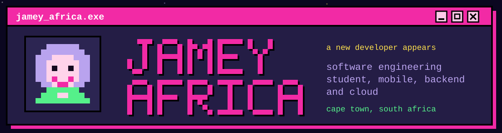

  

  
  &nbsp;
  
  &nbsp;
  
  &nbsp;
  

jameyafrica19@gmail.com

 

## About

Software engineering student at WeThinkCode_ (diploma expected 2027), building mobile, backend and cloud projects in Java, Python, Dart/Flutter and React Native. Former Head of Department with four years of teaching and team leadership. I write tests for what I build and can explain the code I ship.

Open to junior developer roles and internships.

 

## Featured Projects

<table>
  <tr>
    <td width="30%" valign="top">
      <b><a href="https://github.com/jameyafrica/fundazaka">Fundazaka</a></b> 
      React Native · Expo · JavaScript · Supabase Auth
    </td>
    <td valign="top">
      Offline-first budgeting and financial-literacy app for gig workers and informal traders. Budget data stays on the device, encrypted with AES-256-CTR, with an optional biometric lock; Supabase handles login only. Built for the FNB Hackathon, October 2026. 498 Jest tests across 39 suites.
        
    </td>
  </tr>
  <tr>
    <td valign="top">
      <b><a href="https://github.com/jameyafrica/MicroStep">MicroStep</a></b> 
      Dart · Flutter · SQLite
    </td>
    <td valign="top">
      Task tracker that breaks any task into micro-steps and shows only the next action, with a built-in focus timer. Offline-first, with local SQLite storage.
        
    </td>
  </tr>
  <tr>
    <td valign="top">
      <b><a href="https://github.com/jameyafrica/golf-scorecard-pwa">Golf Scorecard</a></b> 
      JavaScript · IndexedDB · PWA
    </td>
    <td valign="top">
      Offline mobile-first app for scoring a round on the course: club, shot direction and a photo per hole, with round history saved on the device. A [Django API](https://github.com/jameyafrica/golf-tracker-api) for it is in progress.
        
    </td>
  </tr>
  <tr>
    <td valign="top">
      <b>CannaComply-SA</b> 
      Django · React · SQL
    </td>
    <td valign="top">
      Backend services and compliance engine for a cannabis inventory management SaaS platform, with full test suites.
        
    </td>
  </tr>
  <tr>
    <td valign="top">
      <b>Robot World Server</b> 
      Java · SQLite · JUnit
    </td>
    <td valign="top">
      Multi-client TCP server with a JSON command protocol and SQLite persistence. 300+ JUnit tests. Group project, built in an Agile team with Docker and CI/CD.
        
    </td>
  </tr>
  <tr>
    <td valign="top">
      <b>Code Clinic Tool</b> 
      Java · JUnit
    </td>
    <td valign="top">
      Java command-line tool that automates student programming workflows. Group project built test-first (TDD) with JUnit and code review.
        
    </td>
  </tr>
  <tr>
    <td valign="top">
      <b>Reading and Numeracy App</b> 
      Dart · Flutter · Figma · In progress
    </td>
    <td valign="top">
      Learning app for ages 6 to 11 with a book library, quizzes and level-based progression.
    </td>
  </tr>
</table>

Robot World Server and Code Clinic Tool are hosted on my school's GitLab. Walkthroughs available on request.

 

## Tech Stack

<table>
  <tr>
    <td width="22%" valign="top"><b>Languages</b></td>
    <td>
      
      
      
      
      
      
      
        
    </td>
  </tr>
  <tr>
    <td valign="top"><b>Mobile and Frontend</b></td>
    <td>
      
      
      
      
      
        
    </td>
  </tr>
  <tr>
    <td valign="top"><b>Backend and Data</b></td>
    <td>
      
      
      
      
      
      
      
        
    </td>
  </tr>
  <tr>
    <td valign="top"><b>Cloud and DevOps</b></td>
    <td>
      
      
      
      
      
      
      
        
    </td>
  </tr>
  <tr>
    <td valign="top"><b>Testing and Practices</b></td>
    <td>
      
      
      
      
      
      
    </td>
  </tr>
</table>

 

## Learning

- **CS50: Introduction to Computer Science**, Harvard / edX
- **SheCodes Basics, Add-on and JavaScript**: HTML, CSS and JavaScript fundamentals. [Coursework on GitHub](https://github.com/jameyafrica/SheCodes-Portfolio)
- **Python and Java Masterclasses**: [Mastering-Java](https://github.com/jameyafrica/Mastering-Java), my public Java roadmap
- **25-day Python challenge**: 24 small Python projects so far. [25_day_challenge_projects](https://github.com/jameyafrica/25_day_challenge_projects)
- **Dart**: [Dartpedia](https://github.com/jameyafrica/dartpedia), a command-line Wikipedia search app, and [Birdle](https://github.com/jameyafrica/birdle), a word-guessing game
- **AWS serverless**: [Serverless-Study-Cards](https://github.com/jameyafrica/Serverless-Study-Cards)

 

## Education

- **Software Engineering Diploma**, WeThinkCode_, South Africa (expected 2027)
- **CodeGirls Cohort 6**, Web Development Phase 1 (expected February 2027)
- **CS50: Introduction to Computer Science**, Harvard / edX

 

## Contact

[Portfolio](https://jameyafrica.github.io) · [LinkedIn](https://www.linkedin.com/in/jamey-africa/) · jameyafrica19@gmail.com · [Cottage Coders on Instagram](https://www.instagram.com/cottagecoders)